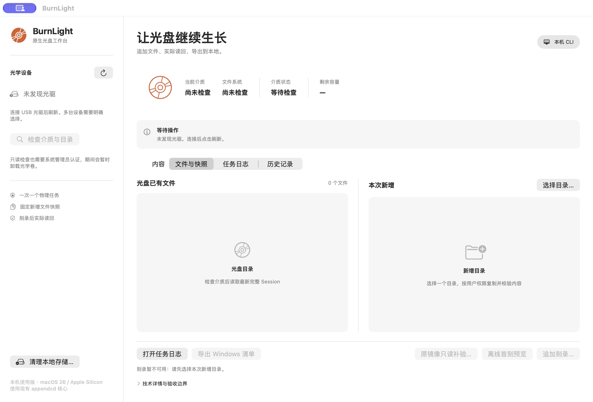

# BurnLight

[简体中文](README.md) | English

A small Mac app for **adding more files to CD-R and DVD-R discs**, with a native interface and a command-line tool.

The main use case: you have a disc written on Windows that still has room for more files, and you want to add files on your Mac, then take it back to Windows to read or append again. You can also start with a blank disc and make the first recording on your Mac.

Each append writes a new batch of content, called a *session*. Existing files that you keep are referenced where they already sit on the disc, so they do not need to be burned again.

Current version: **1.2.2 / build 6**. This project grew out of a personal need and has mainly been tested on an Apple Silicon Mac with a Lenovo XL6M drive. If it helps with your setup, give it a try and share what you find.



## What it does

- **Inspect discs:** detect optical drives, disc type, remaining capacity, and the file tree from the latest complete session.
- **Burn and append:** write the first session to a blank disc, or add files to a disc that has a complete session and is still appendable.
- **Handle existing files:** skip or replace files at the same path, and merge directories with the same name.
- **Export files:** save selected files, directories, or all disc contents locally, with a separate disc read to verify the content.
- **Check recordings:** read back the disc after writing, verify new and existing files, and keep logs, images, and diagnostic materials.
- **Manage local storage:** preview and clean up materials from completed tasks.

> CD-R and DVD-R are write-once media. Replacing a file only updates the latest directory to point to the new version. The old data stays on the disc; it cannot be erased, and the space cannot be reclaimed.

## Supported setups

| Item | Current support |
| --- | --- |
| System | Apple Silicon / macOS 26 and 27; confirmed working on real hardware running macOS 26.6 and macOS 27 |
| Discs | CD-R and DVD-R; appending requires an appendable disc with its previous session fully completed |
| Existing disc formats | ISO9660 / Joliet and supported UDF 1.02 or UDF 2.01 / VAT layouts |
| First recording | Creates an ISO9660 + Joliet disc and leaves it open for later sessions |
| Drive selection | Automatic with one drive; explicit selection required with multiple drives |

There is no brand or model allowlist. The app checks the drive's recording capabilities and the disc's state. **That does not mean every drive has been tested.**

CD-RW, DVD-RW, and Blu-ray are currently unsupported. Intel Macs and older macOS versions have not been tested. Windows is part of the disc-sharing workflow; BurnLight itself runs on Mac.

UDF support is limited to specific layouts. For UDF recordings, each newly added file must be smaller than 1 GiB. Symbolic links, special files, and some filename or format conflicts are rejected. See the [technical notes](docs/implementation.md) for details.

## Build and open the app

### If you are an AI agent

Follow the [build prompt](docs/build-prompt.md).

### If you are human

Continue below for the build instructions.

The repository does not include a prebuilt app. The build scripts currently expect:

- An Apple Silicon Mac running macOS 26 or 27.
- Homebrew, Python 3, and Xcode Command Line Tools.
- The macOS 26 SDK at `/Library/Developer/CommandLineTools/SDKs/MacOSX26.sdk`. The backend build script currently uses this fixed path.

After getting the source, run these commands from the project root:

```sh
# Install dependencies
brew install cdrtools libisofs libudfread cmake pkgconf smake

# Verify and restore the reference files needed for packaging; fills in missing files only
python3 gui/scripts/restore-reference.py

# Build the separate recording backend for UDF 2.01 / VAT
python3 scripts/build-cdrecord.py --vat --output-dir build-vat-backend-v9

# Build the app; physical writing is disabled by default
./gui/scripts/build.sh
open gui/output/BurnLight.app
```

The VAT backend build downloads a pinned version of the cdrtools source and checks its SHA-256 hash. If you have built it before and the script reports that the source directory already exists, add `--resume` to the same command when rebuilding.

**The default build is read-only.** It can inspect discs, export files, and preview recording images. To enable physical recording, close the app and rebuild:

```sh
BURNLIGHT_ENABLE_WRITES=1 ./gui/scripts/build.sh
open gui/output/BurnLight.app
```

The resulting `.app` bundles the tools and libraries it needs at runtime and can be moved to your Applications folder. It uses a local ad hoc signature, without Developer ID signing or notarization. The current packaging workflow is primarily intended for use on the machine where you build it.

See the [repository and build guide](docs/repository.md) for more about reference files, backends, and rebuilding.

## How to use it

The current app interface is in Chinese; the relevant button labels are included below.

1. **Connect a drive and insert a disc.** A single drive is selected automatically. Choose the target if you have more than one.
2. **Click “检查介质与目录” (inspect disc and files).** Check the disc state and existing files first. Drive access prompts for macOS administrator authentication. The system handles your password; the app does not store it.
3. **Choose the folder to burn.** The app prepares a fixed copy, preserves its directory structure, and ignores `.DS_Store` files in the new input.
4. **Preview the recording.** For files at an existing path, choose to skip or replace all conflicts for this task. A successful preview means the image passed validation; nothing has been written to the disc yet.
5. **Confirm the first recording or append.** The app checks the disc again, writes the session, then reads it back to verify the result. Keep the drive connected and wait for the task to finish.

To retrieve files, inspect the disc, select files or directories, and export them. With nothing selected, you can export everything. Each export creates a separate local directory without overwriting existing files. It preserves names, directories, and content, but does not restore original permissions, timestamps, or extended attributes.

Task history and archives are stored under `~/Library/Application Support/BurnLight/`. Disc caches and images can use a lot of space. Use “清理本地存储…” (clean up local storage) to preview what can be removed. Diagnostic materials may include original input files and local paths, so review them before sharing. The app does not upload them automatically.

### If a recording fails

**Check the disc and logs before trying another burn.** An error can occur after data has already been written. Repeating the burn will use more disc space.

Keep the failed task's original image, matching `.manifest`, and task materials. “原镜像只读补验” (read back using the original image) checks the existing recording without writing another session. Normal appending stops if a session is incomplete. Recovery only covers a few verified DVD-R layouts; it is not a general damaged-disc repair tool.

Low-level drive access temporarily pauses the macOS Disk Arbitration service and resumes it afterward. Recovery after abnormal exits has not completed all fault tests against the real system service. If the task has ended but macOS still cannot recognize disks, you can try resuming the service in Terminal:

```sh
sudo kill -CONT "$(pgrep -x diskarbitrationd)"
```

## Command-line use

The command-line tool keeps its original name, `appendcd`. First install dependencies, restore the reference files, and build the VAT backend as described above. Then compile the current source:

```sh
cmake -S . -B build-cli -DCMAKE_BUILD_TYPE=Release \
  -DCMAKE_OSX_SYSROOT=/Library/Developer/CommandLineTools/SDKs/MacOSX26.sdk \
  -DCMAKE_OSX_ARCHITECTURES=arm64
cmake --build build-cli -j 4
./build-cli/appendcd help
```

Use `build-cli/appendcd`. The file at `build/appendcd` is a historical reference checked during app packaging.

List drives, inspect a disc, and list its files:

```sh
./build-cli/appendcd drives
sudo ./build-cli/appendcd inspect --work-dir artifacts/physical
sudo ./build-cli/appendcd list --work-dir artifacts/physical
```

Make the first recording on a blank disc:

```sh
sudo ./build-cli/appendcd init ~/Desktop/Burn --work-dir artifacts/physical
```

Add files to an appendable disc with a complete existing session:

```sh
sudo ./build-cli/appendcd burn ~/Desktop/Burn --work-dir artifacts/physical
```

Replace `~/Desktop/Burn` with your folder. The CLI rejects files at existing paths by default. To handle them explicitly, add `--on-conflict skip` or `--on-conflict replace` to `burn`.

With multiple drives, run `drives` first, then pass an address from its output with `--device`, for example `--device 1,0,0`. Do not use `/dev/diskN` here. Avoid using the GUI and CLI to access the drive at the same time.

Run `help` for offline image creation (`init-build` / `build`), image validation (`verify`), and read-only recording checks (`readback`). Image validation needs the matching `.manifest` and any caches it references. Recovery details are in the [technical notes](docs/implementation.md).

## What has been tested

Real CD-R and DVD-R recordings have been tested with a Lenovo XL6M drive, including the round trip “append on Mac → read and append on Windows → read back on Mac.” Coverage varies by format and operation. These results do not guarantee compatibility with other drives, firmware, or discs.

Version 1.2.2 mainly fixes UDF 2.01 / VAT directories becoming unreadable after repeated file updates on Windows. Verification used a DVD-R with 12 completed sessions: all 9 files were read twice independently and compared with local copies using SHA-256. No new recording was made during that fix's verification. See the [1.2.2 verification report](docs/udf201-windows-updates-20261019.md).

For development, the following checks do not perform physical recording:

```sh
ctest --test-dir build-cli --output-on-failure
./gui/scripts/test.sh
```

`test.sh` rebuilds a read-only app. To burn afterward, rebuild with writing enabled as shown above. Some historical export checks depend on real-disc caches that are not included in Git and cannot be reproduced from source alone. Passing offline tests does not count as a new physical-disc or Windows test.

## Further reading

The detailed development and verification documents are currently in Chinese.

- [Repository and build guide](docs/repository.md): repository contents, reference restoration, and separate builds.
- [Detailed GUI records](gui/README.md): features, permissions, and verification across releases, including historical notes.
- [Technical notes](docs/implementation.md): filesystem handling, how appending works, and limited recovery procedures.
- [DVD-R / UDF 2.01 round-trip test](docs/udf201-dvd-r-roundtrip-20261013.md): actual use between Mac and Windows.
- [Early experiment log](docs/experiments-2026-10-09.md): development history, failures, and fixes.

Absolute local paths, task IDs, and disc addresses in historical documents refer to those particular test runs. The corresponding large images, user files, and full logs are not included in the repository.

BurnLight uses cdrtools, libisofs, and libudfread. Third-party license notices are bundled in `Contents/Resources/ThirdPartyNotices/` inside the built app. The repository also includes the [CDDL notice](backend/CDDL.Schily.txt).
