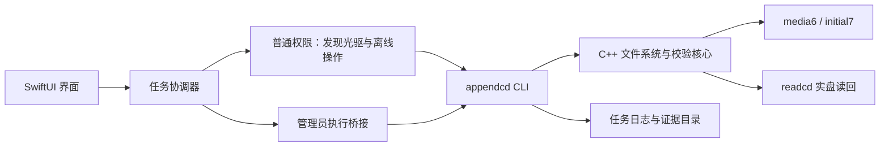

# BurnLight 原生 macOS GUI 制作与交接指南

更新时间：2026-10-10。项目根目录：`/Users/luzove/Documents/Projects/BurnLight`。

实施状态更新：独立 `gui/` 本机开发版现已实现，构建/操作/证据与未完成边界见 [gui/README.md](../gui/README.md)。最初只读交付已归档，随后用户明确授权当前 CD-R 与 Desktop/Burn 实盘验收，并解除源码限制加入同路径跳过/替换；新结果见 gui/evidence/write-acceptance-20261010/acceptance.md。本指南下文保留开发前交接方案，建议内容不等于分发 helper 或物理写入路径已验收。

第一版采用 **SwiftUI + 少量 AppKit + 现有 appendcd CLI**。GUI 负责选光驱、选新增文件、展示状态、管理员执行和实验记录；文件系统、物理地址、刻录参数和实盘读回仍由已经验证的 C++ 核心完成。

本指南是下一位 agent 的开发任务依据。本文中的 GUI 文件结构、状态机、helper 和 JSON 协议均为建议方案，尚未实现。不要把它们当作现有 CLI 参数或已经验收的能力。

## 1. 当前已经完成什么

源码与接口依据是 [src/main.cpp](/Users/luzove/Documents/Projects/BurnLight/src/main.cpp)、[CMakeLists.txt](/Users/luzove/Documents/Projects/BurnLight/CMakeLists.txt)、[实现说明](/Users/luzove/Documents/Projects/BurnLight/docs/implementation.md)，实验依据是 [实验记录](/Users/luzove/Documents/Projects/BurnLight/docs/experiments-2026-10-09.md)。

| 能力 | 当前证据与边界 |
| --- | --- |
| Windows 首刻 → Mac 追加 → Windows 读取/再追加 | DVD-R 实际闭环通过；CD-R 连续三次追加通过由用户反馈，目录/几何有本机证据 |
| Mac 首刻 → Windows 读取并追加 → Mac 读回：DVD-R | [验收记录](/Users/luzove/Documents/Projects/BurnLight/artifacts/initial-roundtrip/acceptance.json)：2 Sessions / 2 Tracks，latest=93952，NWA=100272，appendable |
| Mac 首刻 → Windows 读取并追加 → Mac 读回：CD-R | [验收记录](/Users/luzove/Documents/Projects/BurnLight/artifacts/cd-initial-roundtrip/acceptance.json)：2 Sessions / 2 Tracks，latest=11702，NWA=18904，appendable |
| Joliet 与 UDF 两条追加路径 | ISO 输入以 Joliet 树为权威；UDF 输入使用受支持的 UDF 1.02 树；旧文件沿用旧数据 extent |
| CD-R / DVD-R 分别选择写入方式 | CD-R：TAO / XA；DVD-R：incremental data；均保持可追加，由核心选择 |
| 自动发现光驱、写前身份和介质检查 | 无型号白名单；同型号设备仍按各自 IOKit 服务身份区分；多驱要求明确目标 |
| 中断后特定 DVD-R 预留 Track 的恢复 | 限定布局的恢复、读回与 Windows 人工验收已通过；不是通用恢复器，不能用于 CD-R |

两个 Mac 首刻闭环都使用 Lenovo Ultraslim DVD XL6M。Windows 文件可见性/打开/追加来自用户实际操作；Windows IOCTL 和源文件自动 hash 报告尚未采集。Mac 端有实际光盘读回，不只是准备镜像验证。其他光驱、固件、多台光驱同时工作的实盘结果仍需分别验收。

上述 LBA 只用于理解历史实验，**GUI 不能拿这些数字作为下一次任务的地址**。

## 2. 先保护当前版本

已经保存一份包含当前 `init` 和 `burn` 的 GUI 开发前快照：

- [baseline.tar.gz](/Users/luzove/Documents/Projects/BurnLight/artifacts/baseline-before-gui/20261010-101609/baseline.tar.gz)
- [sha256.json](/Users/luzove/Documents/Projects/BurnLight/artifacts/baseline-before-gui/20261010-101609/sha256.json)
- [快照索引](/Users/luzove/Documents/Projects/BurnLight/artifacts/baseline-before-gui/latest.json)

归档 SHA256：`7fbc96176a7d118e66d0915f61b7037ac2a8068a5645ea302bad4fc9964d57fe`。

快照包含源码、patch、脚本、测试、小 fixture、当时文档、当前 CLI/core 静态库、两个 runtime 刻录后端和关键验收记录。大型 optical cache、Homebrew dylib、完整上游源码不在归档中；原始证据仍在项目的 artifacts 目录。这个归档是恢复基线，不是可随处部署的软件包。

`artifacts/baseline-before-init` 是更早的追加版本，缺少当前首刻功能。GUI 开发应以新的 `baseline-before-gui` 为对照。

已验证的两个后端必须继续分开：

| 用途 | 当前 runtime | 原始二进制 SHA256 |
| --- | --- | --- |
| 已录盘追加/限定 DVD 恢复：media6 | `/Users/luzove/.local/libexec/appendcd/appendcd-cdrecord` | `588515140fb7e5f74dc064f31f561a6a96be8178cda5f414e0f16ada44e63d17` |
| 空白盘首刻：initial7 | `/Users/luzove/.local/libexec/appendcd/appendcd-initial-cdrecord` | `c8c69b90718bdeb02dee95810b0a3f1be9e1df6e3334f2eeb339a0ec4c4c424e` |

开发约束：

1. GUI 新代码放在独立 `gui/`，新构建产物放在独立目录。不要让 Xcode/SwiftPM 重写现有 CMake。
2. 第一版优先直接调用现有 CLI，不改 ISO/UDF writer、地址计算、目标检查、后端 patch 和 Disk Arbitration guard。
3. 如果必须增加机器接口，只做明确的适配改动，保持无新参数时的 CLI 行为，单独记录 diff 和验证结果。
4. 不清理历史 artifacts，不覆盖已有 `.iso/.manifest`，不替换当前两个 runtime 来试验打包。
5. 需要回退时先把快照解压到新的临时目录核对，再选择性恢复。不要直接覆盖当前目录里的新工作。

本项目目前没有 Git 仓库，不要假设已有 branch/worktree 可以回滚。开始开发时核对上面的快照和源码 hash；若项目后来建立了 Git，再使用其实际版本管理状态。

## 3. GUI 架构与目录



建议文件结构，名称可以调整：

```text
BurnLight/
├── src/                         # 当前 C++ 核心
├── backend/                     # 当前两个后端使用的 patch
├── tests/                       # 当前 CLI 回归
├── gui/
│   ├── Package.swift            # 第一阶段可用 SwiftPM
│   ├── Sources/BurnLightApp/
│   │   ├── App/
│   │   ├── Models/              # Drive、Disc、Job、FileEntry
│   │   ├── Services/            # CLI runner、管理员桥接、staging、日志
│   │   ├── ViewModels/          # 界面状态与任务协调
│   │   └── Views/
│   └── Tests/
├── scripts/                     # GUI build/package 脚本新增在这里
└── docs/gui-development-guide.md
```

界面始终以普通用户运行。不要把整个 SwiftUI App 提权。异步 runner 和任务协调器处理进程与 I/O，界面状态更新回到 MainActor；不要在主线程调用等待进程结束的阻塞操作。

**所有物理操作全局串行。** `inspect/list/build/readback` 虽不写盘，也会卸载光学卷、暂停全局 Disk Arbitration 并访问独占设备，不能与 burn/init 或另一台光驱的任务并发。GUI 第一版一次只允许一个物理任务；独立终端的 CLI 不受 GUI 队列控制，发现占用或服务状态异常必须停止，不能绕过核心检查。

## 4. 第一版界面范围

使用原生窗口、原生文件选择和中文状态提示，先完成以下流程：

1. **光驱与介质**：显示设备名称、盘型、空白/可追加状态、剩余容量；单驱自动选择，多驱明确选择。
2. **已有文件**：已录盘可以读取最新 Session 的目录。空白盘不调用 list，显示尚无文件。
3. **本次新增文件**：第一版选择一个目录，展示相对路径、文件数与合计大小，匹配 CLI 的目录输入。
4. **操作**：空白盘显示“首次刻录”，已有完整且可追加的盘显示“追加刻录”；介质状态未知/不支持时禁用。
5. **任务状态**：展示准备、刻录、关闭 Session、读回验证、完成/需要检查。
6. **记录**：可以打开本次日志目录、查看错误详情、导出与 Windows 验收有关的清单。

如果支持拖入多个文件/目录，GUI 必须先整理成一个 staging 根目录，并展示最终相对路径；不能平铺目录、静默改名或覆盖重名文件。先做好目录选择，再扩展拖放。

默认界面不用用户填写 SCSI 地址、LBA、Track mode、刻录速度或文件系统版本。可把这些只读信息放在“技术详情”。普通用户需要知道本次增加什么、目标是谁、是否通过读回。

原基线目录同名允许合并，旧文件同名拒绝；用户随后授权的 1.1 新增显式跳过/替换同路径普通文件，目录/文件及 Windows 名称碰撞仍拒绝，旧数据不能删除。预览可以提前提示冲突，但最终结果由 CLI 的名称与文件系统检查决定。当前核心递归排除新增 `.DS_Store` 普通文件，已有同名旧文件保留；GUI 不需要改盘上的旧树。

不加入擦除、整盘封盘、自动重试刻录、任意 SCSI 命令、音频 CD、RW/BD、GUI 内重写文件系统等额外功能。限定 DVD 恢复先保留为高级 CLI 操作，不放进普通“重试”按钮。

## 5. 现有 CLI 的真实命令契约

开发前运行：

```sh
/Users/luzove/Documents/Projects/BurnLight/build/appendcd help
```

下面的参数均已存在；`CLI` 表示受信任的绝对可执行文件路径，`FILES` 是输入目录，`IMAGE` 是镜像路径，`WORK` 是证据父目录，`DEVICE` 是本次发现的 `bus,target,lun`。表中的命令是参数关系，程序中要使用 argv 数组。

| 界面动作 | 命令 | root | 写入光盘 |
| --- | --- | --- | --- |
| 发现光驱 | `CLI drives` | 否 | 否 |
| 当前盘检查 | `CLI inspect --device DEVICE --work-dir WORK` | 是 | 否 |
| 已录盘目录 | `CLI list --device DEVICE --work-dir WORK` | 是 | 否 |
| 空白盘离线预览镜像 | `CLI init-build FILES IMAGE` | 否 | 否 |
| 已录盘 continuation 预览镜像 | `CLI build FILES IMAGE --device DEVICE --work-dir WORK` | 是 | 否 |
| 验证镜像 | `CLI verify IMAGE` | 否 | 否 |
| 空白盘首刻 | `CLI init FILES --device DEVICE --work-dir WORK` | 是 | 是 |
| 已录盘追加 | `CLI burn FILES --device DEVICE --work-dir WORK` | 是 | 是 |
| 写后只读补验 | `CLI readback IMAGE --device DEVICE --work-dir WORK` | 是 | 否 |

接口要点：

- `drives` 不需要 root，但没有光驱时当前 CLI 返回非零，并输出 `No native optical drive detected`；GUI 把它呈现为无设备状态。
- `inspect` 支持空白盘。已录盘的 inspect 探测文件系统，不等于完整列目录；`list` 才是目录入口。
- `init-build` 不接受 device/work-dir 等选项；输出目录要事先存在，镜像用新的文件名。
- `init` 只接受完全空白盘；`burn` 不接管空白盘。不要在首次刻录失败后盲目换成 burn 再试。
- `init` 和 `burn` 会自行生成、验证、写入并实盘读回。不要在 GUI 再直接调用 cdrecord。
- 当前没有“刻录已准备 IMAGE”的命令。`build` 预览成功后，开始 burn 仍传 **同一份固定输入目录**，由核心重新扫描/构建/验证。
- `verify` 依赖同名 `IMAGE.manifest`，continuation 还可能依赖 manifest 指向的旧 source cache；只导出 ISO 不等于导出了完整可验证材料。
- 物理调用不传 `--last/--next/--source-base` 或离线 `--source`，真实地址由核心从当前盘读取。
- root 权限不仅用于写入；当前物理 inspect/list/build/readback 同样要求 root。
- 普通异常 exit=1；被核心捕获的信号返回 `128 + signal`。管理员桥接的退出状态不能无条件当成 CLI 原始退出状态。

已有恢复命令是 `recover FILES [--prepare-only]` 和 `recover-finish IMAGE`，二者仍受限定 DVD-R 布局检查。`recover --prepare-only` 不写盘，但会读盘建立基线；真正 recover 和 recover-finish 会改变光盘。第一版 GUI 不需要暴露它们。

## 6. 权限实现分两步

### 6.1 本机 GUI PoC：保留系统管理员认证路径

现有实验通过 macOS 的 `do shell script ... with administrator privileges` 执行受信任 CLI。第一版可以封装这个系统认证路径，以最小改动跑通界面；密码由系统对话框处理，GUI 不收集、不记录、不缓存密码，也不要使用 `sudo -S`。

局限必须写进实现：AppleScript 管理员执行不是流式 CLI transport，不能承诺实时输出、精确阶段或可靠取消 root worker。先显示不确定进度，任务结束后读取结果与日志。把 AppleScript 终止并不代表 root CLI 已终止；不能据此启动第二个任务。

如果桥接需要 shell 字符串，每个参数必须单独进行可靠的 POSIX quoting，再对完整字符串进行 AppleScript string 编码；不能拼接用户文件名、JSON.stringify 的结果或带反引号/`$()` 的文本。测试源目录路径中有空格、中文、单引号、美元符号的情况。通用 runner 使用绝对 executableURL 与 arguments 数组。Foundation 提供 Process 与 Pipe 输出接口，但 Process 本身不提权。[Apple standardOutput](https://developer.apple.com/documentation/foundation/process/standardoutput)

当前 `scripts/admin-run.sh` 不是已验证的 GUI 权限桥接：管理员进程读取 Documents 下这个脚本曾被 TCC 拒绝。不要把现有脚本文件直接当成最终产品的权限方案。

本阶段固定使用本机已核对的 CLI 和 runtime 路径；用户可写的开发目录/runtime 不能作为分发版本的 root 信任依据。

### 6.2 可分发版本：签名 helper + 明确的任务接口

推荐另做 `SMAppService` LaunchDaemon 与 XPC 桥接，由 helper 以管理员身份启动受信任 CLI。macOS 13+ 提供该 API，daemon 需要管理员启用；不能认为调用 register 后立即可以运行。[Apple helper 文档](https://developer.apple.com/documentation/servicemanagement/updating-helper-executables-from-earlier-versions-of-macos)，[WWDC22 管理员 daemon 说明](https://developer.apple.com/videos/play/wwdc2022/10096/)

本机 SDK 的 `SMAppService.h` 已核对：`daemon(plistName:)`、`register()`、`status`；包含 daemon 的 App 需要签名/公证，服务注册和更新有自己的生命周期要求。helper 的安装、签名、授权与光驱独占访问尚未在本项目验证，必须作为独立工作项，不能声称第一版 GUI 就具备这些能力。

helper 接收有限的 typed job 请求：操作枚举、选定设备、输入快照标识、证据任务标识；不接受任意 shell、任意 executable、任意 cwd 或由客户端传来的 root 清理目标。校验客户端身份、请求和文件边界，具体签名/XPC API 以安装 SDK 与官方文档为准。[Apple NSXPCConnection](https://developer.apple.com/documentation/foundation/nsxpcconnection)

授权拒绝、尚需系统设置批准、helper 不存在、签名不符和连接中断都要有明确 UI 状态。应用更新、helper unregister 和 backend 替换不能发生在物理任务执行期间。CLI worker 仍保留原 guard/watchdog，helper 不自行接管它的 STOP/CONT 流程。

## 7. 文件访问与 staging

真实实验已经证明：**管理员权限不等于 TCC 文件访问许可**。root 执行器可能运行 CLI、写新证据，却读不了 Desktop/Documents 中的现有输入。

建议流程：

1. 普通用户 GUI 通过 NSOpenPanel/fileImporter 获得输入目录，由 GUI 确认能实际打开文件。
2. 只把本次新文件复制到独立私有任务目录，保留名称、子目录和内容；不复制光盘已有文件。
3. 复制时拒绝 symlink/特殊文件；检测重名与源文件变化。选择源目录后不要使用外部 `cp` shell 拼接文件名。
4. 构建预览和实际刻录使用同一份固定输入快照。失败时保留它，以便诊断；任务结束后按保留策略清理。
5. 开发 PoC 可沿用 `/private/tmp` 中的私有 staging；可分发 helper 必须验证提交内容并建立自己控制的快照，避免信任用户可变路径或 symlink。

GUI 可以保持目录书签用于重新访问；有 security scope 时，在访问期间成对 start/stop，并处理 stale bookmark。书签提供 GUI 的文件访问，不自动赋予任意 root 子进程同样的 TCC 权限。[Apple 文件访问说明](https://developer.apple.com/documentation/security/accessing-files-from-the-macos-app-sandbox)

第一版本机 PoC 可先以普通非 App Sandbox 应用验证链路；这只是 App 自身构建选择，不涉及关闭 SIP/TCC 或修改全局安全设置。后续若采用 App Sandbox，单独验证书签、helper 通信及文件传递，不能只加 entitlements 就宣称可用。

不用 chmod 777 或“给所有目录完全磁盘访问”来代替 staging。对 root 使用的任务目录、日志/export 路径和清理操作要限制到本任务，不能递归 chown/remove 用户任意路径。

## 8. 工作目录与证据生命周期

`--work-dir` 是**证据父目录**。CLI 每次创建新的 `run-XXXXXX` 子目录，里面保存镜像、manifest、TOC/msinfo、readcd cache、有效块清单、写入日志、result/failure 和 Windows 预期清单。它不是用户文件来源，也不是光盘上的目标文件夹。

GUI 界面可称“实验记录位置”，默认折叠。建议 GUI 保存持久任务索引，临时 staging 与持久 evidence 分开；具体目录位置需要在所选权限方案下验证。不能直接断言 Application Support 中的文件都能被管理员执行器读取。

原 CLI 创建的 evidence 在运行时可能是 root-owned/private，退出时会尝试交还拥有者。普通 GUI 不能依靠实时读取这个目录来保证进度。helper 方案应通过自己的 job 管理返回可访问的结果，并只导出本任务材料。

continuation manifest 的 sourcePath 可能是绝对 cache 路径。移动证据包时要保留 `.blocks` 和缓存，检查/更新引用后再 verify；不要把 sparse hole 当作实际读过的零块。导出或清理必须处理整个依赖集合。

首版建议失败/写后待检查的任务不自动删除，成功任务按用户选择保留/导出；缓存可能很大，先显示占用，不自动清除尚需 readback/verify 的材料。

## 9. 状态机、失败与取消

建议状态是 GUI 模型，当前 CLI 没有直接输出这些枚举：

```text
idle → discovering → ready → staging → preparing
     → writing → closingSession → readingBack → completed

preparing 之前的明确失败 → failedBeforeWrite
已启动物理 writer 后的失败/中断/状态未知 → needsInspection
任意连接丢失但 worker 状态未知 → taskStateUnknown
```

关键规则：

- 任务绑定当次选定设备；刷新或换盘后旧 ready 状态失效。执行前仍让 CLI 重新校验，不能复用 UI 缓存的 NWA。
- `build/verify` 成功只能表示镜像通过验证；`cdrecord exit=0` 也不能表示最终成功。
- init/burn 结束且实盘 readback 成功、Session/Track 和 appendable 均符合预期，才显示“刻录与读回验证完成”。这不代表每一张新盘都已在 Windows 实机验收。
- 发生物理写入后异常，不自动重新调用 init/burn，不提供一键重新刻录默认动作。用户曾三次重复 burn 留下 DVD-R 预留区，错误与恢复有明确历史证据。
- 先 inspect；若记录已完成而只缺即时读回，使用原镜像/manifest 只读 readback。CD-R 不走 DVD 恢复；不符合限定恢复条件时保留诊断。
- 缺少 cdrecord 日志不证明“没有写盘”：中断可能发生在写日志之前。未知阶段按需要检查处理。

第一版允许用户取消文件选择/staging/尚未提交的任务；物理刻录/关闭 Session 中不提供硬杀进程按钮。关闭窗口应让任务继续，禁止释放任务资源或另起任务；管理员桥接无法可靠管理存活 root worker 时，宁可保持任务占用状态。

未来增加取消时，通过拥有任务的管理员执行器向**对应 CLI PID**请求协作式停止，等待 guard 和子进程清理，再实际检查介质；不能只杀 cdrecord/osascript，不能按进程名批量 kill，也不能把“取消”当作光盘内容回滚。

已有 guard/watchdog 的正常恢复路径已观察通过，虚拟进程故障测试通过；真实服务 SIGINT/SIGKILL 故障注入的最终版本尚未通过验收，旧实验两次需要用户手动 CONT。第一版 GUI 不重复此类真实故障注入，不承诺任意强杀都能自动恢复。GUI 本身不额外 STOP diskarbitrationd，也不卸载正在管理任务的 helper。

高级故障说明可提供既有手动恢复命令，但先确保本任务的设备操作已结束，不能在仍持有独占设备的 writer 上运行自动 CONT：

```sh
sudo kill -CONT "$(pgrep -x diskarbitrationd)"
```

## 10. 进度与机器接口

当前 stdout/stderr 为人类日志，没有 `--json`、`--events-json`、百分比或阶段回调参数。不要在 GUI 代码里直接传这些未实现选项。

第一版可以使用严格的文本适配器：识别有限的稳定字段，保留完整 stdout/stderr；不认识/重复/缺失关键字段就展示原日志并停止依赖该字段的操作。文件名输出使用 C++ `std::quoted`，不要按空格拆 FILE 行。GUI 多个进程的输出分别保存，不让大日志堵住管道。

有直接 Process/helper 输出流时可以使用已观察到的 writer 文本辅助显示阶段；AppleScript PoC 无流式输出时显示 spinner。不能伪造整体百分比。写入与 fixate 时间不同，Session 关闭期间保持活动状态；外层短超时不能把正常关闭当作卡死。核心 writer timeout 目前为 1800 秒，watchdog 的 90 秒失联阈值也不是 GUI 的任务超时。

如果下一阶段确有需要，新增版本化 JSONL 事件作为**独立 CLI 适配改动**，让机器事件与原日志分流，保留默认文本模式。建议字段：schemaVersion、jobID、sequence、operation、phase、event、device、media、evidenceDirectory、exitCode、result、physicalWriteState。进度未知时 progress=null；结果与地址直接取当前 DiscInfo/Manifest，不能从 UI 猜。

下面仅是拟议事件示例，当前程序不会输出：

```json
{"schemaVersion":1,"jobID":"example","sequence":7,"operation":"burn","phase":"readingBack","event":"phaseStarted","progress":null,"physicalWriteState":"completedPendingReadback"}
```

stdout 的 cout 缓冲、stderr 的实时 backend 输出以及管理员桥接的缓冲行为都需要考虑。第一次 GUI 不必为进度重构刻录核心。若新增结构化接口，必须验证无参数的旧命令、所有原回归及关键镜像/extent 行为保持。

## 11. 文件系统与核心边界

GUI 不重新实现 Joliet 与 ISO 短名称映射、UDF 导入、LBA 重定位或文件数据复用。查看/预览都尊重核心返回的权威树：ISO/Joliet 输入优先 Joliet，UDF bridge 输入当前优先 UDF；首刻输出 ISO9660 + Joliet。

名称策略由 [Util.cpp](/Users/luzove/Documents/Projects/BurnLight/src/Util.cpp) 与 merger 决定：Windows 大小写/Unicode 冲突、保留名称、尾部点/空格等会拒绝；当前单个名称上限为 103 UTF-16 units，不是“整条路径最多 103 字符”。同名文件不覆盖，symlink/特殊文件拒绝。UDF 新文件当前必须小于 1 GiB，不能把这个 UDF 限制无条件施加到 ISO 分支，也不能在 GUI 放开后绕过核心。

已有元数据修正/双端序/path table/旧 extent/文件 hash 校验是必要路径。禁止为了进度或速度跳过旧文件 hash 基线、写前复查、容量边界或写后 readcd。历史上 libisofs Joliet 父目录记录与 cdrtools DVD Track 选择都有实际缺陷，不要用 stock mkisofs/cdrecord 替换修补路径。

## 12. 本机工具链与后续打包

当前 C++ 依赖：libisofs 1.5.8.pl02、libudfread 1.2.0、cdrtools 3.02a09 两个隔离后端。CLI 是 arm64，CMake 使用 MacOSX26 SDK。

交接时实测：活跃 developer directory 是 CommandLineTools，未安装 `/Applications/Xcode*.app`，`xcodebuild -version` 因没有完整 Xcode 不能工作。Swift 6.3.3 可用；用显式 MacOSX26 SDK、arm64/macOS 14 target 对 SwiftUI/AppKit/Foundation/SMAppService 最小源码 typecheck 已通过。此项只是工具链检查，没有构建 GUI App 或安装 helper。

第一阶段可用 SwiftPM 开发 SwiftUI，再用脚本组装本机 `.app`；若后来使用完整 Xcode，单独配置项目，不修改系统全局 xcode-select 来解决本项目构建。建议 GUI deployment target 先设 macOS 14+，实际只在当前 macOS 26.6 验证，别声称旧系统已测试。

当前默认 SDK 指向 MacOSX27.0，原 C++ 链接曾与其不兼容。GUI agent 的构建脚本应明确选择 SDK，并实际验证编译/链接；不要仅凭 Swift 的 typecheck 推断 GUI 整体链接已通过。

现有 CLI 回归命令：

```sh
cd /Users/luzove/Documents/Projects/BurnLight
cmake --build build -j 4
ctest --test-dir build --output-on-failure
```

有 C++ 适配改动时建议新建构建目录，并显式保留两个 runtime：

```sh
cmake -S /Users/luzove/Documents/Projects/BurnLight \
  -B /Users/luzove/Documents/Projects/BurnLight/build-gui-core \
  -DCMAKE_BUILD_TYPE=Debug \
  -DCMAKE_OSX_SYSROOT=/Library/Developer/CommandLineTools/SDKs/MacOSX26.sdk \
  -DCDRECORD_PATH=/Users/luzove/.local/libexec/appendcd/appendcd-cdrecord \
  -DINITIAL_CDRECORD_PATH=/Users/luzove/.local/libexec/appendcd/appendcd-initial-cdrecord
cmake --build /Users/luzove/Documents/Projects/BurnLight/build-gui-core -j 4
ctest --test-dir /Users/luzove/Documents/Projects/BurnLight/build-gui-core --output-on-failure
```

这组命令依据当前 CMake 配置，GUI 本身的具体 build/package 命令由下一位 agent 编写并现场验证。

开发版先使用既有路径；可分发版需要单独处理：

- 当前 CLI 动态链接 `/opt/homebrew/opt/libisofs/lib/libisofs.6.dylib` 与 `/opt/homebrew/opt/libudfread/lib/libudfread.3.dylib`；CMake 还编入 cdrecord/readcd 的绝对路径。直接复制一个 appendcd 到 App 不会变成自包含应用。
- readcd 也要随产品依赖处理。两个后端不能混成一个，不降级成 Homebrew stock cdrecord。
- bundle 内路径、dylib install name/rpath、签名、公证及 helper 可执行位置都需要新的打包构建和 provenance。先修改加载信息再签名；签名/重定位后二进制 hash 会变化，另记打包产物 hash，原 runtime 仍保留。
- root 从 Documents 下打开 cdrtools 的 IOKit plugin 曾失败，换到用户 libexec 后成功。bundle/helper 的新运行位置必须实际测试，不能推断移动后必然有独占访问。
- 保留上游许可证和来源/hash记录；打包产物与开发版分开验收。

## 13. GUI 验收要求

先用模拟 runner/真实历史文本做 UI 与桥接测试，再做只读接盘；不要为了开发界面自动消耗当前已经验收的实验盘。

| 层级 | 必须覆盖 |
| --- | --- |
| UI/任务模型 | 无光驱、未插盘、空白、可追加、满盘/封盘、未完成 Session、单驱/多驱、断开重插、未知状态禁用写入 |
| 文件与参数 | 中文、空格、长名、目录、源路径单引号/美元符号、冲突、不支持名称、symlink、`.DS_Store`、复制期间源变化 |
| 进程桥接 | 授权取消/失败、大 stdout/stderr、不完整文本、无法解析、worker 状态未知、UI 关闭期间任务存活、不重复启动 |
| 只读集成 | GUI 的 drives/inspect/list/readback 与 CLI 结果一致；目标身份和盘型检查仍有效，Disk Arbitration 正常恢复 |
| CLI 回归 | 有任何 CLI/core 适配时跑六组既有 CTest；如有内存相关变动，再跑已有 ASan/UBSan 配置，macOS LeakSanitizer 不算通过 |
| 实盘 GUI 链路 | 使用用户指定的实验盘和小文件，按首次/追加及 CD/DVD 分别记录；从 GUI 发起、实际光盘读回、仍 appendable |
| Windows | GUI 打包/权限路径有变化时，按对应盘重新确认 Windows 能读新旧文件/可追加；沿用 master 操作，不强迫用户改为脚本首刻 |

现有六组测试是 offline_multisession、udf_multisession、backend_target、recovery_image、drive_selection、initial_session，最近 Debug 和 ASan/UBSan 均 6/6，通过日志在 `artifacts/initial-development`。这些历史结果不代表新 GUI 或打包版本已通过。

每个里程碑交付实际源码、构建/运行命令、GUI 操作记录、CLI/core diff、依赖与后端 hash、失败日志和未完成边界。不要把 SwiftUI Preview、模拟进度、ISO verify、Session 数或 cdrecord exit=0 当作整条 GUI 刻录流程成功。

## 14. 建议开发顺序

1. 核对基线，独立 GUI 工程，用模拟 runner 做设备/目录/任务/日志界面。
2. 接入无 root 的 drives、init-build、verify；验证参数数组与文件 staging。
3. 接入系统管理员认证的只读 inspect/list，再接 explicit init/burn；第一版使用不确定进度，保持原 CLI。
4. 验证实盘 readback 和写后失败状态，提供日志与只读补验入口，不自动重烧。
5. 如需要更完整进度，再以小改动提供版本化机器接口，回归原 CLI。
6. 可分发 helper、依赖封装、签名/公证另做里程碑；换执行位置后重验硬件链路。

第一版交付重点是能从 GUI 安全、清晰地完成现有功能。不要先重构已经完成 CD-R/DVD-R 双向验收的 C++ 核心。

## 15. 可直接复制给下一位 agent 的任务说明

```text
请在 /Users/luzove/Documents/Projects/BurnLight 开发原生 macOS GUI。
先阅读 docs/gui-development-guide.md、README.md、docs/implementation.md，
核对 artifacts/baseline-before-gui/latest.json 和对应源码/二进制快照。

采用 SwiftUI + 必要 AppKit，普通用户 GUI 包装现有 appendcd CLI。
本机只有 CommandLineTools，可先用 SwiftPM；使用明确 SDK，实际编译运行。
新增代码放独立 gui/，不要覆盖当前 build/appendcd 或两个 runtime 后端。

第一版实现：自动发现/选择光驱、显示盘型/空白/可追加/容量、读取已录盘目录、
选择本次新增目录并 staging、空白 init/已有完整 Session burn、任务状态与日志、
成功后实际读回结果、写后失败进入检查而非自动重烧。

保持 C++ ISO/Joliet/UDF writer、旧 extent 重用、CD/DVD 参数选择、
写前身份/介质/地址/容量/metadata/hash 检查、读回和 Disk Arbitration guard。
GUI 不直接执行 cdrecord，不猜 LBA，不把 init/burn 自动互换。
所有物理命令全局串行，包括只读 inspect/list/build/readback。

CLI 目前无 JSON/进度 API；先使用严格文本适配和不确定进度。
管理员认证不保证 Desktop/Documents 文件可读，GUI 以用户权限建立输入快照。
不收集管理员密码，不硬杀 writer/osascript，不在物理任务中更新/卸载 helper。
需要机器接口时只做独立小适配，保持默认 CLI 行为并跑六组原回归。

历史实验已在 Lenovo Ultraslim DVD XL6M 上完成 CD-R 和 DVD-R：
Mac 首刻 → Windows 读取并追加 swagger.json → Mac 两次实际光盘读回，仍可追加。
这些是当前 CLI 基线，不代表新 GUI/打包路径已验收。
开发先模拟/离线/只读；真实刻录使用本任务明确指定的实验盘与小文件，
记录实际 GUI 发起、读回、Windows 结果与剩余边界。

交付可编译运行的 GUI、构建脚本、说明、验证证据及明确的未完成项。
不要使用 Electron、Windows VM，不重写 SCSI/MMC 后端，不改永久系统安全设置。
```

## 2026-10-10 本任务最终补充

本机 1.1.1 已实际编译、安装、运行。用户指定当前已有 Session CD-R 后，GUI 两次 burn/实际读回、Windows 七文件可见/正常打开与再次追加、返回 Mac 八文件只读读取/导出均已完成。Windows 为用户人工实机结果，IOCTL 与自动源 hash 未取得。返回盘曾错读旧 Session，已增加核心 msinfo/minfo 与 GUI inspect/list 一致检查；Windows 31-block 小卷改按导入边界识别，生成镜像约束保留。

用户已明确解除全部源码限制，因此共享源码改动在允许范围内；原 build/appendcd、两个 runtime 和 SCSI/MMC 后端仍未覆盖或重写。最终基线 47 项中十个共享源码文件与一个测试文件有授权变化，其他 36 项保持；不得把早期五文件统计或旧 CLI 实验视为当前全部源码/GUI 结果。最终 1.1.1 的实盘验收限于返回盘只读路径，实际两个 GUI burn 发生在 1.1.0，构建绑定分别记录。详见 [最终验收](../gui/evidence/write-acceptance-20261010/acceptance.md)。
